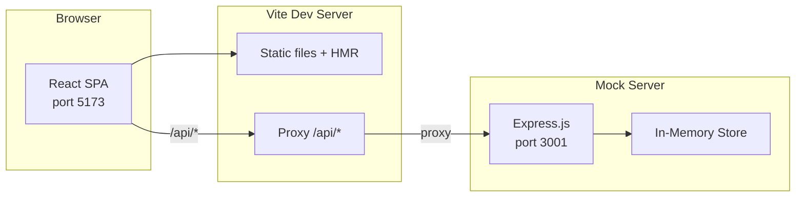
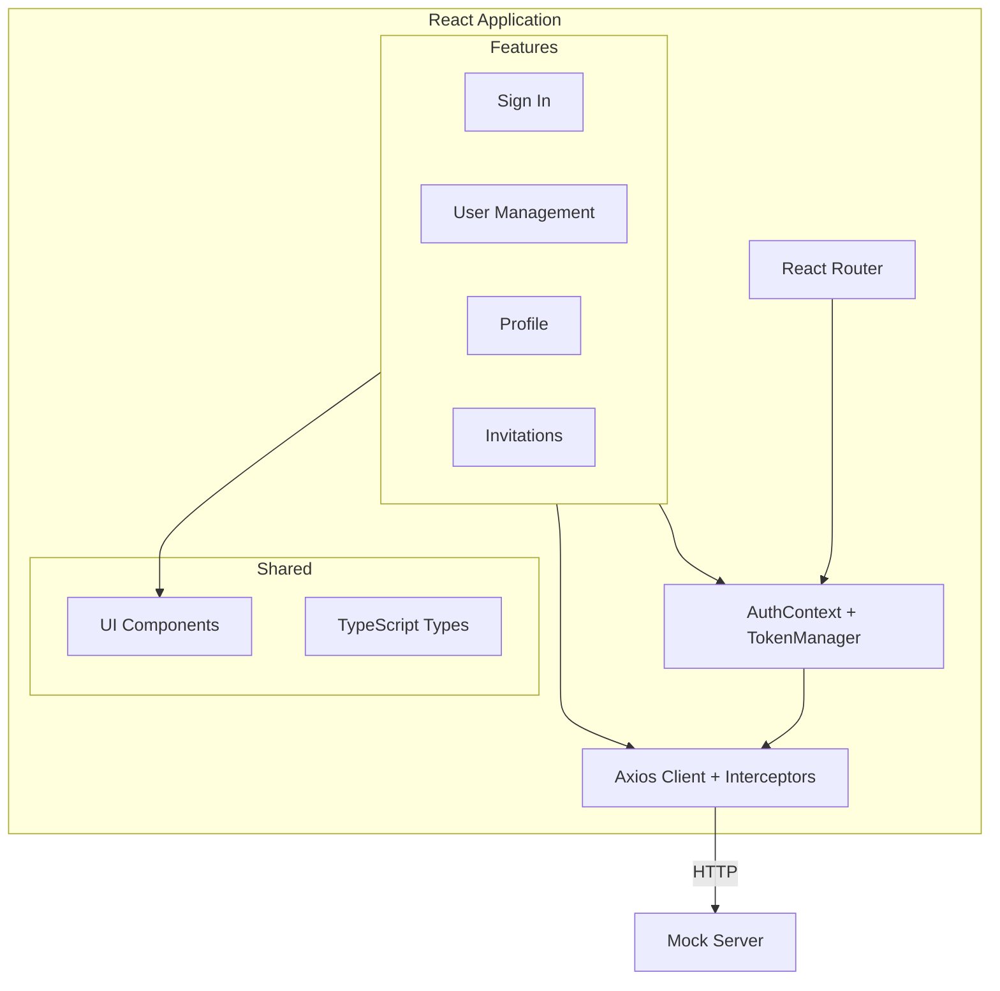
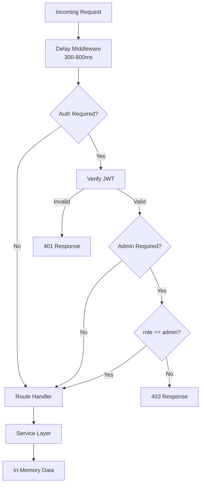

# Architecture

## Overview

The application is a monorepo with two independent processes:

- **Frontend** — A React single-page application served by Vite's dev server (port 5173)
- **Mock Server** — An Express.js API server with in-memory data (port 3001)

Vite's dev server proxies all `/api/*` requests to the mock server, so the frontend uses relative URLs (`/api/auth/signin`) without worrying about CORS or ports.

## System Diagram

## Why a Separate Server Instead of MSW

The assignment requires that changes made by an admin are visible to other users in another tab or browser profile. MSW (Mock Service Worker) runs inside each browser tab's service worker — data changes in tab A are invisible to tab B. A standalone Express server shares one in-memory store across all clients.

## Frontend Architecture

### Data Flow

1. **User actions** trigger feature components
2. Feature components call **API functions** (typed wrappers around Axios)
3. The **Axios interceptor** attaches the access token and handles 401 refresh
4. **TanStack Query** manages caching, loading states, and refetching
5. **AuthContext** holds the current user and role, updated when tokens change

## Mock Server Architecture

