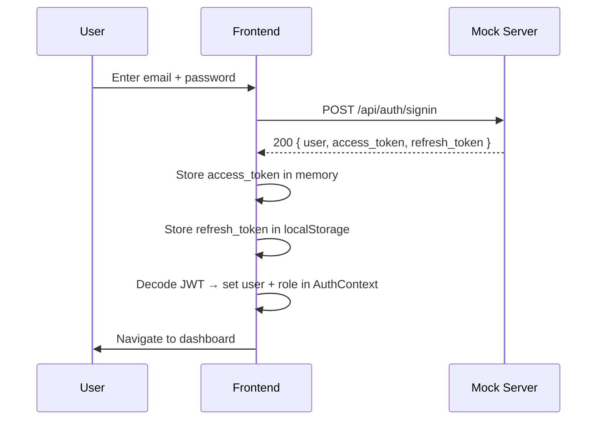
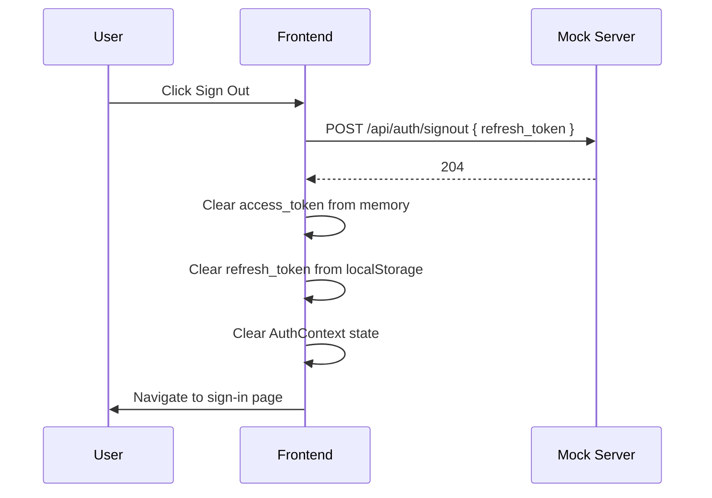
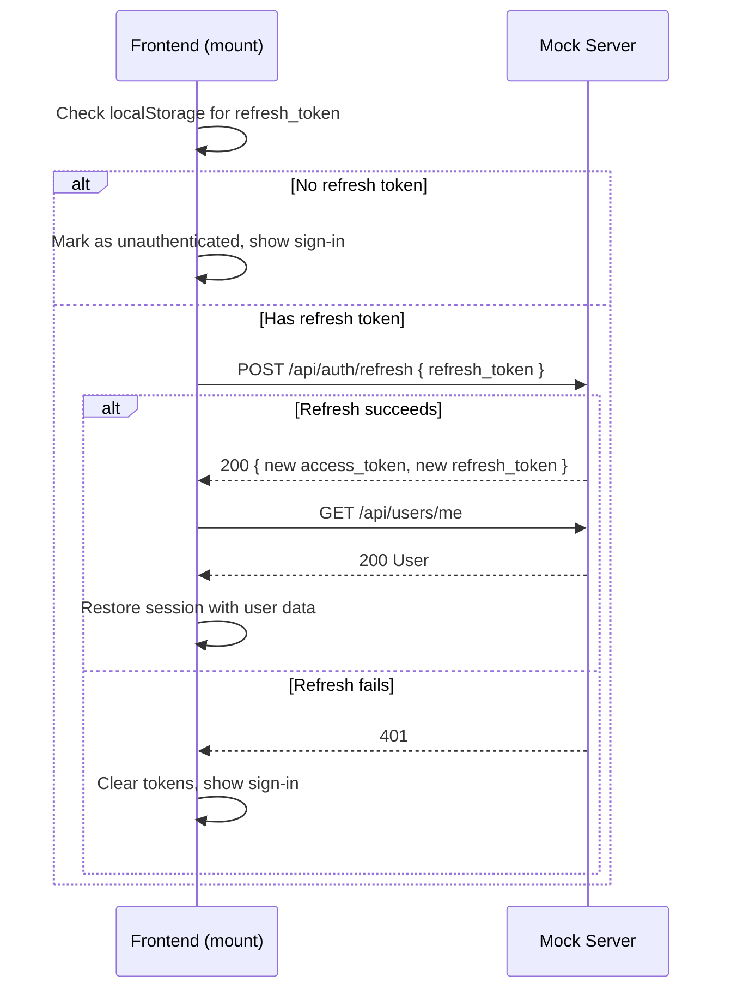
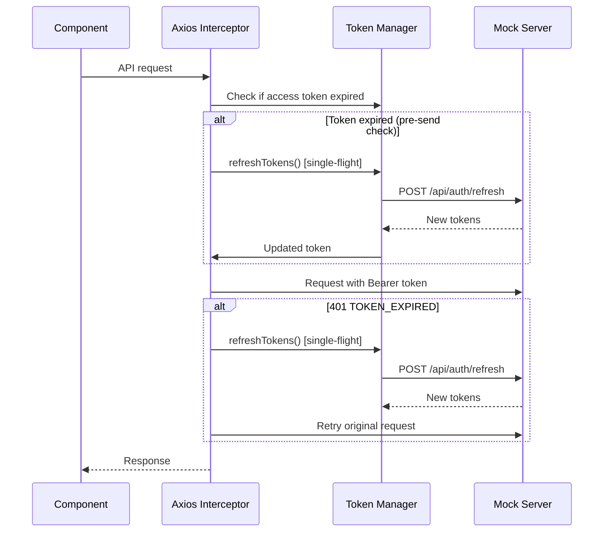

# Authentication Flow

## Sign In

## Sign Out

## Session Restore (Page Reload)

When the page loads, AuthContext checks for a refresh token in localStorage:

## Token Refresh (on API request)

## Deactivation

When an admin deactivates another user:

1. Server revokes all of the deactivated user's refresh tokens
2. The deactivated user's next refresh attempt returns 401 ACCOUNT_DEACTIVATED
3. The frontend clears their session and redirects to sign-in with a message
4. If the deactivated user tries to sign in, they get 403 ACCOUNT_DEACTIVATED

## Role Change

When an admin changes another user's role:

1. The change is stored server-side immediately
2. The affected user's current access token still carries the old role
3. At the next token refresh (within 60 seconds), the new access token carries the new role
4. AuthContext compares the new token's role with the current state
5. If different: AuthContext updates, navigation re-renders, unauthorized pages redirect
